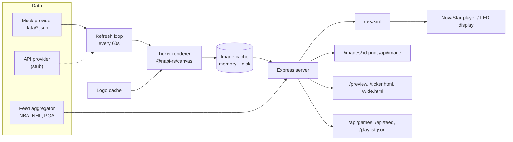

# RSS Sports Ticker

An RSS 2.0 sports ticker that renders broadcast-style PNG frames for NovaStar media players and LED displays.

Live demo: https://rss-sports-feed.vercel.app (try `/preview` and `/rss.xml`)

## Overview

Each game is drawn server-side as a high-resolution ticker image and published in an RSS 2.0 feed whose `<enclosure>` tags point to the PNG URLs. NovaStar players (and any RSS-capable signage player) can subscribe to the feed and display the images directly. The same data is also available as HTML ticker pages, a JSON playlist, and a JSON API.

The project ships with sample NBA, NHL, and PGA data. A provider interface is in place for connecting a live sports data API.

## Features

- **Server-side rendering**: broadcast-style ticker frames drawn with `@napi-rs/canvas`, rendered at 2x and downscaled for sharper LED output
- **RSS 2.0 feed** with image enclosures, plus a JSON playlist and per-image endpoints
- **Game states**: pre-game (scheduled time), live (score, period, clock, LIVE badge), and final
- **Multi-sport feed**: NBA, NHL, and PGA leaderboard items aggregated and sorted with live items first
- **Caching**: rendered PNGs cached in memory and on disk, regenerated only when game data changes; team logos downloaded once and cached
- **Background refresh**: data re-fetched and stale images regenerated every 60 seconds
- **Configurable display**: output resolution, scale factor, and font sizes in one config file
- **Pluggable data**: mock provider by default, with an API provider stub for live data
- **Deploys to Vercel** as a serverless function, or runs as a long-lived Node.js server

## Architecture



### Endpoints

| Path | Purpose |
|---|---|
| `/rss.xml` | RSS 2.0 feed with PNG enclosures |
| `/images/:id.png` | Rendered ticker image for one game |
| `/api/image?id=` | On-demand image, served from cache or rendered fresh |
| `/ticker.png` | Single ticker image |
| `/playlist.json` | JSON playlist of image URLs |
| `/api/games` | Current game data |
| `/api/feed` | Aggregated multi-sport feed |
| `/preview` | Browser preview of all frames |
| `/ticker.html`, `/wide.html` | HTML ticker pages |
| `/health` | Health check |

## Tech stack

TypeScript, Node.js, Express, `@napi-rs/canvas`, Vercel serverless functions.

## Getting started

```bash
npm install
npm run dev
```

Then open `http://localhost:3000/preview` or `http://localhost:3000/rss.xml`.

### Environment variables

| Variable | Default | Purpose |
|---|---|---|
| `PORT` | `3000` | Server port |
| `HOST` | `0.0.0.0` | Bind address |
| `BASE_URL` | `http://localhost:3000` | Public URL used in RSS enclosure links |
| `DATA_PROVIDER` | `mock` | `mock` or `api` |
| `SPORTS_API_KEY` | empty | Key for a live sports data API |

### Configuration

Display and font settings live in [`src/config.ts`](src/config.ts):

```ts
display: {
  width: 384,      // output width in pixels
  height: 192,     // output height in pixels
  scaleFactor: 2,  // render at 2x, then downscale
}
```

For larger LED panels, increase the resolution (for example `768x384`) and scale the font sizes proportionally.

### Game data

Sample data is in `data/mockGames.json`, `data/mockNhl.json`, and `data/mockPga.json`. Each team entry takes a `name`, `abbr`, hex `color`, optional `record`, and optional `logoUrl` (an empty value renders a fallback badge with the abbreviation).

### Connecting a live data source

1. Implement `fetchGames()` in [`src/dataProviders/apiProvider.ts`](src/dataProviders/apiProvider.ts) and map the response to the `Game` interface in `src/types.ts`.
2. Set `DATA_PROVIDER=api` and `SPORTS_API_KEY`.

Rendering, caching, and the RSS feed work unchanged.

### NovaStar setup

1. Run the server where the player can reach it, and set `BASE_URL` to that address.
2. In the NovaStar software, add an RSS media source pointing to `<BASE_URL>/rss.xml`.

For remote testing, expose a local server with a tunnel such as `ngrok http 3000` or `cloudflared tunnel --url http://localhost:3000`, and set `BASE_URL` to the public URL it prints.

### Scripts

| Command | Description |
|---|---|
| `npm run dev` | Start with auto-reload |
| `npm start` | Start without auto-reload |
| `npm run build` | Compile TypeScript to `dist/` |
| `npm run serve` | Run the compiled build |

Hosting options (Render, a VPS with PM2, and others) are covered in [DEPLOYMENT-GUIDE.md](DEPLOYMENT-GUIDE.md).

## Project structure

```
api/index.ts               Vercel serverless entry
src/
  server.ts                Express server, refresh loop, routes
  config.ts                Display, font, and refresh settings
  types.ts                 Shared interfaces
  dataProviders/           Mock provider and live API stub
  providers/               NBA, NHL, and PGA feed providers
  feed/feedAggregator.ts   Multi-sport aggregation with caching
  render/renderTicker.ts   Canvas ticker renderer
  rss/generateRss.ts       RSS 2.0 generator
  utils/                   Image cache, logo cache, league logo maps
data/                      Sample game data
fonts/                     Inter font files
```

## License

MIT. See [LICENSE](LICENSE).
